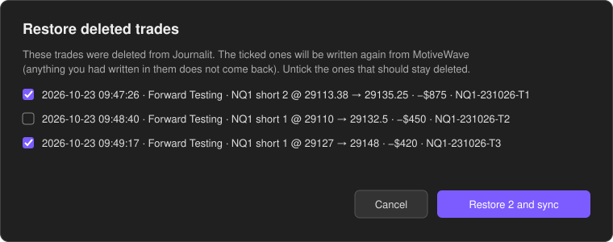

# MotiveWave → Journalit

*[Read in English](README.md)*

Um plugin do [Obsidian](https://obsidian.md) que registra as suas trades fechadas no **MotiveWave** como notas
de trade do **[Journalit](https://journalit.co)**. Funciona com a conta simulada e com as contas reais. Ele
também preenche o stop inicial, o R, o MAE e o MFE.

Você opera no MotiveWave e abre o Obsidian. As trades já estão no diário, organizadas por data, esperando você
colocar o setup, a tese e os prints.

> Sem vínculo com o MotiveWave ou o Journalit. O plugin lê arquivos que o MotiveWave grava no seu computador.
> O formato desses arquivos não é documentado, então uma atualização do MotiveWave pode mudá-lo. Veja
> [Testado com](#testado-com).

## O que ele faz

- **Lê todos os workspaces do MotiveWave e todas as contas de cada um**, inclusive a conta `simulated`. Os fills
  viram trades do zero ao zero: aumentar ou reduzir a posição fica dentro da mesma trade, e uma virada de mão
  vira duas trades.
- **Grava no formato e nas pastas do próprio Journalit.** Uma trade vai para
  `!Journalit/2026/Q4/10/W43/trades/NQ1-221026-T1.md`, com cada fill como entrada ou saída. O Journalit indexa a
  nota como se você tivesse lançado à mão.
- **Preenche stop, R, MAE e MFE.** O stop é a primeira ordem de stop que você colocou na trade, tirada do log de
  ordens do MotiveWave. MAE e MFE são calculados tick a tick pelo cache de ticks do MotiveWave.
- **Nunca duplica.** Se você já lançou a trade à mão (mesma conta, lado, entrada até 2 minutos de diferença e
  mesmo preço), o plugin liga a trade a essa nota em vez de criar outra. Rodar o sync duas vezes não grava nada
  novo.
- **Nunca sobrescreve o que é seu.** Se o MotiveWave ainda não salvou o stop ou os ticks, o plugin tenta de novo
  nos syncs seguintes, por três dias. Ele só preenche campos que estão vazios.
- **Recupera trades deletadas quando você pede.** O **Forçar sync** lista as trades que você deletou do
  Journalit, e você marca quais quer de volta.
- **Roda só no seu computador.** Nada é enviado para lugar nenhum.

## Requisitos

- **Obsidian desktop** 1.4 ou mais novo, com o plugin **Journalit** instalado e configurado.
- **MotiveWave**, usado no mesmo computador do vault.
- **Python 3.9 ou mais novo.** Só a biblioteca padrão é usada.
  - **Windows:** instale pelo [python.org](https://www.python.org/downloads/) e rode
    `py -m pip install tzdata`. Sem o `tzdata`, os horários saem no fuso do seu computador em vez do fuso do
    MotiveWave (normalmente Nova York).
  - **macOS:** qualquer um destes: [python.org](https://www.python.org/downloads/), Homebrew
    (`brew install python`) ou as Command Line Tools da Apple (`xcode-select --install`, que trazem o Python
    3.9). Não precisa de mais nada.
  - **Linux:** o `python3` da distribuição.

## Instalação

### Opção 1: BRAT (recomendado)

1. No Obsidian, instale o **BRAT** pelos plugins da comunidade.
2. BRAT → *Add beta plugin* → `ijustgotanidea/motivewave-journalit`.
3. Configurações → Plugins da comunidade → ative **MotiveWave → Journalit**.

### Opção 2: manual

1. Baixe `main.js` e `manifest.json` da
   [release](https://github.com/ijustgotanidea/motivewave-journalit/releases) mais recente.
2. Coloque os dois arquivos em `<seu vault>/.obsidian/plugins/motivewave-journalit/` (crie a pasta).
3. Reinicie o Obsidian. Depois, Configurações → Plugins da comunidade → ative **MotiveWave → Journalit**.

### Opção 3: pelo código-fonte

```bash
git clone https://github.com/ijustgotanidea/motivewave-journalit
cd motivewave-journalit
python scripts/install.py "C:/Users/voce/Documents/Meu Vault"
```

Reinicie o Obsidian e ative o plugin. Para atualizar, rode o mesmo comando de novo; as configurações são
mantidas.

## Primeiro uso

Abra **Configurações → MotiveWave → Journalit**:

1. **Registrar trades a partir de**: o plugin preenche com o dia da instalação, para não importar o histórico
   antigo. Coloque uma data anterior se quiser trazer trades mais velhas.
2. **Nomes das contas**: ligue o id de cada conta do MotiveWave ao nome que ela tem no Journalit, uma por linha:

   ```
   simulated = Forward Testing
   APEX-12345-01 = Apex 50K
   ```

   Contas fora da lista ficam com o id do MotiveWave. O id da conta simulada é `simulated`.
3. Clique em **Sincronizar agora**.

## No dia a dia

- **Abrir o Obsidian** registra as trades fechadas novas (dá para desligar).
- **Sincronizar agora**, nas configurações, ou o comando **Forçar sync** fazem o mesmo na hora. Se você deletou
  trades do Journalit, primeiro aparece esta lista:

  

  Desmarque as que devem continuar deletadas. *Cancelar* não faz nada; desmarcar todas só sincroniza.
- Depois de cada trade, coloque setup, tese, erros e imagens no Journalit, como sempre.

> **Quando a trade aparece?** Só depois que o MotiveWave a grava em disco. Ele grava ao ser fechado, e o auto
> save do workspace pode gravar antes (a cada 2 minutos na instalação testada). Se uma trade que você acabou de
> fechar não apareceu, espere uns minutos, ou feche o MotiveWave, e force o sync.

## O que é preenchido

| Campo | De onde vem |
| --- | --- |
| Direção, instrumento, contrato, conta | Fills do MotiveWave |
| Entradas e saídas (horário, preço, tamanho) | Fills do MotiveWave, no fuso do workspace |
| PnL | Bruto, pelo valor do ponto; comissão vai como 0 |
| Stop loss | Primeira ordem de stop colocada do lado da saída durante a trade |
| R | PnL bruto ÷ (\|entrada média − stop\| × tamanho × valor do ponto) |
| MAE / MFE | Pior e melhor PnL (aberto + realizado) em qualquer tick da trade, em dólares |
| Setup, tese, erros, imagens, comissões | Ficam com você |

Uma trade fechada a mercado, sem ordem de stop, fica sem stop, e o R fica 0.

## Configurações

| Configuração | Padrão | Observação |
| --- | --- | --- |
| Sincronizar ao abrir o Obsidian | ligado | |
| Registrar trades a partir de | dia da instalação | Trades anteriores são ignoradas |
| Pasta de workspaces do MotiveWave | onde o MotiveWave guarda | Windows `%APPDATA%\MotiveWave\workspaces`, macOS `~/Library/MotiveWave/workspaces`, Linux `~/.motivewave/workspaces` |
| Pasta do diário do Journalit | a do próprio Journalit | Padrão `!Journalit` |
| Nomes das contas | `simulated = Simulated` | `id no MotiveWave = nome no Journalit` |
| Instrumentos | lista embutida | `RAIZ = nome no Journalit, $ por ponto, tick` |
| Comando do Python | automático | `py -3`, `python`, `python3` ou o caminho completo |

Instrumentos embutidos: NQ (`NQ1`), MNQ, ES (`ES1`), MES, YM, MYM, RTY, M2K, CL, MCL, GC, MGC, SI, mais ENQ e
EP (os nomes do NQ e do ES na CQG). Acrescente outros contratos, ou renomeie estes para bater com os
instrumentos do seu Journalit, por exemplo `NQ = NQ, 20, 0.25`.

## Como funciona

O plugin carrega um pequeno motor em Python (`motivewave_journalit.py`, gravado na pasta do plugin). Ele lê
três coisas na pasta de dados do MotiveWave:

| Arquivo | Para quê |
| --- | --- |
| `workspaces/<nome>/config/trade_history.csv` | Todos os fills de todas as contas |
| `workspaces/<nome>/config/journal.csv` | Eventos de ordem, para o stop |
| `historical_data/<feed>/<contrato>/*.tick_data(.zip)` | Ticks, para MAE e MFE |

O motor só grava as notas de trade novas no seu vault, mais um arquivo de estado e um log fora dele:
`%LOCALAPPDATA%\motivewave-journalit\` no Windows, `~/Library/Application Support/motivewave-journalit/` no
macOS, `~/.local/state/motivewave-journalit/` no Linux. O estado guarda quais trades já foram registradas. Ele
é separado por vault, então dois vaults nunca se misturam.

O motor também roda pelo terminal:

```bash
python motivewave_journalit.py --vault "C:/caminho/do/vault" --config "C:/caminho/do/vault/.obsidian/plugins/motivewave-journalit/data.json" sync --dry-run
```

## Testado com

- **Windows 11:** MotiveWave 7.1.2 com conexões Rithmic e CQG, Journalit 1.9.3, Python 3.9 e 3.14.
- **Linux (Ubuntu 24.04):** os testes do motor, mais um sync completo sobre uma cópia de dados reais do
  MotiveWave, com resultado idêntico ao do Windows.
- **macOS:** ainda não rodou num Mac. As pastas de dados são as que o próprio código do MotiveWave 7.1.2 usa
  (`~/Library/MotiveWave`), e a busca do Python no macOS é coberta por testes, mas ninguém confirmou num Mac de
  verdade. Se você testar num Mac, abra uma issue, dando certo ou não.

## Limitações

- **macOS não foi testado num Mac de verdade** (veja acima). Se o plugin não achar trades, confira se
  `~/Library/MotiveWave/workspaces` existe, ou preencha *Pasta de workspaces do MotiveWave*.
- **MAE/MFE dependem do cache de ticks do MotiveWave**, que só existe para contratos cujos ticks o MotiveWave
  carregou ou salvou. Ligar *Save Live Ticks* nas configurações de dados históricos do MotiveWave (Rithmic, CQG
  e CTS) mantém esses ticks. O formato do cache foi conferido com dados da Rithmic. O cache da CQG usa um
  formato mais antigo, que não é lido, então trades na CQG ficam sem MAE/MFE.
- **PnL e R são brutos.** A tabela de comissões do MotiveWave costuma estar vazia, então o plugin grava comissão
  0. Lance os custos reais no Journalit.
- **Só trades fechadas** são registradas. Uma posição aberta entra quando zerar.
- Recuperar uma trade deletada a reconstrói a partir do MotiveWave. O que você tinha escrito na nota deletada se
  perde.

## Problemas comuns

- **Nada aparece.** Confira *Registrar trades a partir de* e force o sync. Se ainda não aparecer, feche o
  MotiveWave para ele gravar e force de novo. O log mostra o que aconteceu: `sync.log` na pasta de estado acima.
- **"Python 3 não foi encontrado".** Windows: instale o Python pelo python.org marcando *Add python.exe to PATH*.
  macOS: instale por uma das opções em Requisitos. Ou coloque em *Comando do Python* o caminho completo do
  `python3` (`python.exe` no Windows).
- **Horários com algumas horas de diferença.** No Windows, rode `py -m pip install tzdata`.
- **Nome ou valor do ponto errado.** Acrescente uma linha em *Instrumentos*.
- **Nome da conta errado.** Acrescente uma linha em *Nomes das contas*. As trades já gravadas ficam com o nome
  antigo; corrija no Journalit.

## Desinstalar

Desative e remova o plugin no Obsidian. As suas notas de trade continuam lá. Para esquecer também quais trades
foram registradas, apague a pasta de estado acima.

## Desenvolvimento

```bash
python -m unittest discover -s tests   # motor
python build.py && node tests/plugin.test.cjs   # plugin, com o Obsidian simulado
```

`src/main.js` é o plugin e `src/motivewave_journalit.py` é o motor. O `build.py` embute o motor no
`dist/main.js`. Para publicar uma release: suba a `version` no `manifest.json` e no `versions.json`, rode
`python build.py` e crie uma release no GitHub com a tag dessa versão, anexando `dist/main.js` e
`dist/manifest.json`. O BRAT instala a partir desses dois arquivos.

## Licença

[MIT](LICENSE)
